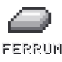

# Ferrum



Ferrum is a client-side Fabric mod that makes Minecraft run better on weak hardware: Intel and AMD
integrated graphics, older laptops, and Android phones running Minecraft through launchers such as
Zalith, Pojav or MJ with GL layers like MobileGlues and GL4ES. It speeds up the vanilla renderer,
skips work that cannot be seen, and replaces Video Settings with a full options screen.

Ferrum is client-side only. It works on any server, and other players do not need it.

## Supported versions

| Minecraft | Java | Download |
|---|---|---|
| 26.3 | 25 | `ferrum-<version>+26.3.jar` |
| 1.21.11 | 21 | `ferrum-<version>+1.21.11.jar` |

Requires [Fabric Loader](https://fabricmc.net/) 0.20.1+ and Fabric API.
On Android, use the **1.21.11** build: Minecraft 26.x needs SDL3, which current Android launchers do
not ship (see [Android and low-end devices](docs/MOBILE.md)).

## Features

### Rendering
- **Block face culling** – chunk meshes are stored grouped by face direction, and faces pointing
  away from the camera are never sent to the GPU. On a typical view this is a third to half of
  all terrain faces.
- **Render pass optimization** – block faces whose texture has no transparent pixel are drawn in
  the solid pass instead of the slower cutout pass (grass blocks are the most common case).
- **Occlusion culling** – a background thread traces rays through the world and skips mobs, items,
  chests, signs, banners and other block entities hidden behind walls or underground.
- **Render scale with FSR** – draw the 3D world at 50–100% resolution and upscale it with an
  FSR 1-style upscaler (edge-adaptive upsampling + contrast-adaptive sharpening). The HUD and text
  stay at full resolution.
- **Animate only visible textures** – animated blocks (fire, portals, sculk, kelp...) are only
  updated when a visible chunk uses them.
- **Lightmap cache** – the lightmap is only redrawn when lighting actually changes.

### Game
- **Entity tick culling** – far, off-screen mobs update less often on your side; the server is unaffected.
- **Entity and block entity distance culling**, a particle limiter and ambient effect density.
- **Dynamic lights** for held torches, glowing items and burning or luminous mobs.
- **Adaptive quality** – lowers Ferrum's own budgets when FPS drops and restores them afterwards.

### Settings
- **Video Settings replacement** with pages for General, Quality, Performance, Details, Render,
  Dynamic Lights and Advanced. Changes are staged with Undo / Apply / Done, and every option has
  a description.
- **Render page** in the style of Sodium Extra: per-type toggles for animations, particles, item
  frames, armor stands, paintings, name tags, beacon beams and more.
- **Hardware presets** (Auto, Potato, Mobile, Low-End, Balanced, Quality). Auto detects Android,
  GL translation layers, Apple, Intel, AMD and NVIDIA GPUs. Presets only ever lower settings and
  never limit the frame rate.
- **F3 report** – Ferrum's status appears on the right side of the debug screen: active preset,
  graphics path, render scale and upscaler, culling counters and compatibility.

## Compatibility

Ferrum detects other performance mods and turns off any of its own features that would overlap,
so two mods never do the same job twice.

| Mod | What happens |
|---|---|
| Sodium | Ferrum's terrain features and Video Settings replacement turn off; everything else keeps working |
| Iris | Supported through Sodium; render scale pauses while a shader pack is active |
| VulkanMod | Terrain features, render scale and lightmap cache turn off |
| BadOptimizations | Ferrum's lightmap cache turns off |
| EntityCulling | Ferrum's occlusion culling and entity tick culling turn off |
| Lithium, FerriteCore, ModernFix, ImmediatelyFast, More Culling, C2ME, Krypton, Dynamic FPS | No overlapping features |
| Mod Menu | "Configure" button opens Ferrum's settings |

Details: [docs/COMPATIBILITY.md](docs/COMPATIBILITY.md). `/ferrum status` and the F3 screen list
what Ferrum detected and what it handed over.

## Usage

Open the settings from **Options → Video Settings**, press **F6**, use Mod Menu, or run `/ferrum config`.

| Command | Description |
|---|---|
| `/ferrum status` | Hardware, graphics path, compatibility and live counters |
| `/ferrum preset <auto\|potato\|mobile\|low\|balanced\|quality>` | Apply a preset |
| `/ferrum set <key> <value>` | Change one setting (tab completion lists keys) |
| `/ferrum reload` | Reload `config/ferrum.json` |
| `/ferrum hud` | Toggle the debug HUD |

## Documentation

- [Wiki](wiki/Home.md) – installation, settings, performance guide, troubleshooting, FAQ
- [docs/MOBILE.md](docs/MOBILE.md) – Android launchers, GL layers and JVM arguments
- [docs/COMPATIBILITY.md](docs/COMPATIBILITY.md) – mod and hardware compatibility
- [docs/ARCHITECTURE.md](docs/ARCHITECTURE.md) – how each feature hooks into Minecraft
- [docs/SODIUM-ANALYSIS.md](docs/SODIUM-ANALYSIS.md) – Sodium-family techniques and what Ferrum implements
- [docs/BUILDING.md](docs/BUILDING.md) – building both versions
- [CONTRIBUTING.md](CONTRIBUTING.md) – how to contribute

## Building

```bash
./gradlew build                    # 26.3   -> build/libs/
./gradlew -p mc1.21.11 build       # 1.21.11 -> mc1.21.11/build/libs/
```

The 26.3 build needs JDK 25; the 1.21.11 build works with JDK 21 or newer.

## License

MIT, see [LICENSE](LICENSE). Ferrum contains no code from Sodium, Embeddium or other renderer mods.
